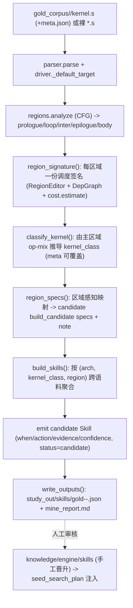

# Gold 语料 skill 挖掘（Mode A 静态）— 技术原理与实现

> 目标：把一批**人工调好（roofline 级）的 kernel** 当作"标准答案"，**静态**分析出**按区域（prologue/loop/epilogue）**
> 的调优先验，产出 `candidate` skill，指导后续未优化 kernel 的指令调优方向。
>
> 本文档讲"已落地的 Mode A 怎么实现、为什么这么实现"；动机与按区域学习的论证见
> `proj/brainstorm/mine_skills_from_gold_kernels.md`；skill 的注入/晋升机制见 `proj/knowledge_agent_design.md`。
> 实现入口：[tools/mine_corpus.py](../tools/mine_corpus.py)，测试：[unittests/test_mine_corpus.py](../unittests/test_mine_corpus.py)。

---

## 1. 结论

- **静态可挖**：一个成品 kernel 是优化的**终态**。仅凭终态的 `.s`，复用引擎现有分析器即可抽出"好 kernel 长什么样"的
  **调度签名**，再泛化成按区域的导航先验——**全程不跑真机、零风险**。
- **kernel 无关**：所有特征只来自语义指令 `Kind` + CFG 区域 + 依赖 DAG，**不假设 GEMM、不出现 shape（m/n/k…）、
  不绑定 kernel 名**。原先写死的 `loop_kind="mfma_dense"` 由通用结构分类器推导。
- **安全**：产物一律 `status="candidate"`，**永不自动晋升 `trusted`**；写入 `study_case/study_out`，**不触碰
  `knowledge/engine`**；skill 只导航、不裁决（合法性仍由引擎、性能仍由真机裁决）。

---

## 2. 设计原则与红线

| 原则 | 落地 |
|---|---|
| **kernel 无关** | 特征源自 `reorder/model.py` 的语义 `Kind`（mfma/vmem_load/ds_read/salu/valu…）+ `reorder/regions.py` 的 CFG + `reorder/depgraph.py` 的 DAG。`when` 作用域只含 `{arch, loop_kind, region}`，无 shape/kernel 名（测试强制断言）。 |
| **只导航不裁决** | skill 落到 `search.driver.build_candidate` 已认识的 spec 词汇，仅作"先试什么"的先验；挖错只浪费预算，不产坏 kernel。 |
| **Mode A 不晋升** | 静态无真机 delta，故 `status` 恒为 `candidate`；晋升 `trusted` 需 Mode B/在线真机佐证。 |
| **输出隔离** | 产物写挖掘专用的 `DEFAULT_OUT`（`study_case/study_out`，与调优的 `tune_out` 分离）下的 `skills/` 与 `mine_report.md`；人工审核后手工复制进 `knowledge/engine/skills/`。 |

---

## 3. 整体数据流



---

## 4. 调度签名（`region_signature`）

对每个区域构造一个只读 `RegionEditor`（`treat_waitcnt_as_fence=False, protect_prefetch=False`），在 gold 的
**当前顺序**上抽取以下特征（全部 kernel 无关）：

| 字段 | 含义 | 计算 |
|---|---|---|
| `n_instr` | 区域指令数 | `len(order)` |
| `kind_hist` | 语义 `Kind` 直方图 | 统计 `ed.kind_of(iid)` |
| `anchored` | 是否有 MFMA 锚点 | `bool(ed.anchors(Kind.MFMA))` |
| `frac{mfma,vmem,ds,valu,salu,smem}` | 各类占比 | 对应 Kind 计数 / `n_instr` |
| `vmem_load_hoist_median` | vmem load 相对首个 in-region 消费者的提前槽位（越大=越早发、越能掩盖延迟） | 对每个 load 取 `min(succ_pos)-pos[load]`，再取中位数 |
| `gap_fill_avg` | 锚点（MFMA）相邻间隙平均填充指令数 | 相邻 anchor 间内含指令数的均值 |
| `gap_fill_nonuniform` | 间隙填充的非均匀度 | 各 gap 填充数的总体标准差 `pstdev` |
| `gap_fill_kinds` | 间隙里填了哪些 Kind | 统计间隙内指令 Kind |
| `waitcnt_cluster` | 平均每个 waitcnt 排空多少笔异步 op（越大=一拍盖多发） | `RegionCost.wait_stalls / n_waits` |
| `n_waits`/`est_cycles` | 区域 wait 数 / 代价模型估计 | `cost.estimate(prog, target, region)` |
| `prefetch_loads` | 识别出的跨迭代 prefetch 负载数 | `ed.prefetch_info().producers`（异常则 0） |

> 复用而非重造：这些都建立在 `observe()` 已暴露的同一批原语（`kind_of`/`legal_window`/`anchors`/`prefetch_info`/
> `cost.estimate`）之上，保证与运行时调优看到的事实一致。

---

## 5. 通用结构分类器（`classify_kernel`）

替代写死的 `loop_kind="mfma_dense"`。先看 `meta.json` 覆盖（`kernel_class` 或 `family`），否则取**主区域**
（**指令数最大的 `loop`**，否则最大的 `body`，否则最大区域）的占比，按以下规则判定。

> 取"最大的 loop"而非"第一个 loop"很关键：split-k / 流水化 GEMM 常含多个极小控制循环（`loop(4)`/`loop(5)` 自旋/累加块）
> 与真正的大 MFMA 循环并存，若按第一个小循环判类会把 mfma-dense kernel 误判为 `mixed`（本次 23 个真实 bf16 GEMM 语料即暴露此点）。

```
anchored?                         -> mfma_dense (mfma>=0.15) | mfma_sparse
ds  >= 0.25                       -> lds_bound
vmem>= 0.30 且 valu < 0.15        -> memory_streaming
valu>= 0.30                       -> vector_only
其余                               -> mixed
```

`arch` 同理：`meta.arch` 优先，否则默认 `gfx942`（当前唯一 Target）。阈值集中在该函数，便于按语料经验调整。

---

## 6. 区域感知映射（`region_specs`）— 三块不同策略

证据驱动：**只有 gold 区域确实呈现某模式时，才建议对应 spec**。spec 全部来自 `build_candidate` 词汇。

| 区域 | 类型 | 触发条件 → 建议 spec / note |
|---|---|---|
| `loop`/`inter`/`body`(anchored) | 有 MFMA | 间隙含 vmem_load → `distribute_evenly[vmem_load]` + `compact vmem_load earliest`；间隙含 ds_read → `distribute_evenly[ds_read]`；`gap_fill_nonuniform>=1.0` → note 非均匀布局；恒附 `listsched{critical_path:1.5}`。策略=喂饱 MFMA、访存与计算重叠 |
| `prologue` | 无 MFMA | `vmem_load_hoist_median>=2` → `compact vmem_load earliest`（前置首批 load）；有 smem → `compact smem earliest`（hoist scalar load）；附 `listsched{critical_path:1.5,latency:1.0}`。策略=循环前把访存铺出去 |
| `epilogue` | 无 MFMA | note：按依赖 drain、**不 prefetch**；`listsched{critical_path:1.5,latency:1.0}`。策略=尽快排空写出 |
| 其它（anchor-less body/loop） | — | `listsched{critical_path:1.5,latency:1.0}`，按依赖降 est_cycles |

specs 在函数内按稳定 transform id（`kn._transform_id`）去重并保序。

---

## 7. 跨语料聚合与 Skill 产出（`build_skills`）

按 `(arch, kernel_class, region_kind)` 把所有 kernel 的同区域观测分到一组，每组产出一条 skill：

- **specs 排序**：统计每个 spec 被多少 kernel 建议（每 kernel 对同一 spec 只计一次），按出现频次 `most_common` 排序。
- **`when`**：`{arch, loop_kind=kernel_class, region}` —— 仅结构特征。
- **`action`**：`{specs:[排序后的候选], note:出现最多的几条说明}`。
- **`evidence`**：`{kernels:[支撑该组的 kernel], n_samples, source:"gold_corpus(modeA)"}`。
- **`confidence`**：`min(0.9, agreement*(1-1/(n+1)))`，其中 `agreement = 最高频 spec 的支撑 kernel 数 / 组内 kernel 数`
  —— 即"该模式的组内一致率"，随语料量与一致性升高。
- **`effect`**：标注"静态挖掘、未实测（Mode A）"。
- **`status`**：恒为 `candidate`。**`id`**：`gold-<kernel_class>-<region>`。

> 含义：一个 class+region 只有 1 个 gold kernel 时 `confidence≈0.5`；多个同类 kernel 印证同一模式时一致率与置信度上升，
> 挖出的"区域级策略"也更稳健。

---

## 8. 语料布局与 CLI

```bash
# 推荐入口脚本（配置写在脚本顶部 CONFIG 块，每次运行前清空 study_out/skills）
bash study_case/study_script/mine_skills.sh
# 或直接调用：
python3.8 tools/mine_corpus.py [--corpus DIR] [--out DIR]
```

- `--corpus`（默认 `study_case/gold_corpus/`，可指任意外部路径；脚本默认指向
  `/data/feifei/poc_kl/mi300/bf16gemm/shaders`）。两种摆放（`_iter_corpus` 同时支持）：
  - **子目录式**：`<corpus>/<name>/`，含 `*.s`（`kernel.s` 优先）+ 可选 `meta.json`（`arch`/`kernel_class`/`family`）+
    可选可运行物（留给 Mode B）。
  - **裸文件式**：`<corpus>/<name>.s`。
- `--out`（默认 `study_case/study_out`）：产出 `skills/gold-<class>-<region>.json` 与 `mine_report.md`。
- 单个 kernel 解析失败不会中断整批（`mine_corpus` 逐个 try）。

---

## 9. 输出、审核与晋升

1. 跑完看 `study_case/study_out/mine_report.md`（每 kernel 分类 + 按组汇总的候选 skill）与 `skills/*.json`。
2. **人工审核**认可的 skill，手工复制进 `knowledge/engine/skills/`（例：`cp study_case/study_out/skills/gold-mfma_dense-loop.json knowledge/engine/skills/`）。
3. 之后 `agent.knowledge.seed_search_plan` 在调对应区域时按 `when={arch,loop_kind,region}` 自动激活它，作为
   `build_candidate` 候选先验注入搜索/agent。

---

## 10. 与现有知识体系的衔接

```
离线 gold 挖掘 (本文/Mode A)            在线主动调优 (现有)
  static signature (按区域)              真实 transform->delta (experiments.log)
        \                                   /
         \--> 同一个 skill 库 (knowledge/engine/skills) <--/
                        |
                  seed_search_plan (按 region 注入先验)
```

- 离线给广覆盖的**正向先验**（哪个区域重要、哪族变换、权重起点）；在线负责**真机验证 + 补"避免"知识**。
- 两者**作用域 schema 一致**（`agent/knowledge.py` 的 `when` 已含 `region`，`induce_skills` 已按 region 分组），
  天然融合，无需改注入侧。

---

## 11. 局限与后续

- **幸存者偏差**：成品只展示成功终态，学不到"别做什么"（`avoid` 由在线实验补）。
- **迁移有限**：gold 对自身 shape/arch/dtype 最优；故 skill 按结构特征条件化、跨域需重新验证。
- **未做（后续）**：
  - **Mode B**：用 `tools/make_candidate` 合成朴素基线 → `diff(gold, naive)` 还原 transform → `log_experiment` →
    复用 `induce_skills` 晋升 `trusted`（接入真机佐证）。
  - **跨区域 span skill**（软件流水，prologue+loop 协同），呼应主 plan 的 `p4-span`。

---

## 12. 代码索引

| 函数 / 文件 | 职责 |
|---|---|
| `region_signature` | 单区域调度签名（§4） |
| `classify_kernel` / `_primary_region` | 通用结构分类（§5） |
| `region_specs` | 区域感知 spec 映射（§6） |
| `mine_kernel` | 单 kernel → 记录（解析+逐区域签名+分类+spec），**可测试单元** |
| `_iter_corpus` / `mine_corpus` | 语料遍历（子目录/裸文件/meta）（§8） |
| `build_skills` | 跨语料聚合 → candidate Skill（§7） |
| `render_report` / `write_outputs` | 报告与持久化（§9） |
| `main` | CLI |
| [unittests/test_mine_corpus.py](../unittests/test_mine_corpus.py) | 含非 GEMM 的 `kvadd_style.s`；断言 kernel 无关、每区域出签名、产物均 `candidate` 且 `when` 无 shape/kernel 名 |
