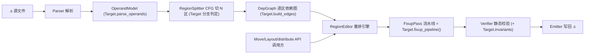

# 指令重排引擎：固定逻辑框架与接口设计

> 目标：设计固定逻辑（非 AI）的指令重排引擎，支持**精细调整指令顺序**（任意重新分配 `ds_read` 等填充物到各 MFMA 间隙）并**自动计算移动后的 `s_waitcnt` 值**。
>
> 调用方（AI / 搜索）只发"对稳定指令 ID 的结构化操作"，引擎负责合法性校验 + `s_waitcnt` 重算 + 回写，调用方不碰寄存器号或 waitcnt 数字。
>
> 本文档是 `core_loop_scheduler_design.md` 的落地细化（聚焦"重排引擎"这一固定逻辑组件）。

---

## 0. v2 评审：架构无关核心 + 独立 ISA 层（testft 工程化前提）

testft **完全独立**（不依赖任何外部工程）。引擎按"**架构无关核心 + 可插拔 ISA 层**"分层：

- **核心引擎（架构无关）**：词法 / 解析 / CFG / 依赖图框架 / 重排（RegionEditor）/ waitcnt 重算框架 / FixupPass 框架 / 校验 / 回写。核心**不含任何具体指令集常量**，只通过 `Target` 接口取用架构知识。
- **ISA 层 `isa/Target`（架构相关）**：opcode 分类、寄存器模型、分支判定、计数器模型（`CounterModel`）、依赖建边规则、修补 pass 流水线（`fixup_pipeline()`）、ATT/perf 语义（`perf_counter_schema()`，把 ATT category 映射到瓶颈维度）、校验不变式。首个实现 `isa/gfx942`；**加新架构 = 新增 `isa/<arch>/`，核心零改动**。

```python
class Target(Protocol):                       # 核心引擎只认这个接口，不认 gfx942
    name: str
    def register_prefixes(self) -> set[str]: ...
    def parse_operands(self, opcode, operand_strs) -> tuple[RegSet, RegSet]: ...  # (defs, uses)
    def classify(self, opcode, operands) -> "Kind": ...
    def is_branch(self, instr) -> bool: ...
    def is_conditional_branch(self, instr) -> bool: ...
    def branch_target(self, instr) -> str | None: ...
    def build_edges(self, region, graph) -> None: ...     # ACC/M0/MEM/FENCE 等架构特有边
    def bundles(self, region) -> list["Bundle"]: ...       # 如 [s_add m0, buffer_load lds]
    def counter_model(self) -> "CounterModel | None": ...  # None=该架构不用 counter
    def fixup_pipeline(self) -> list["FixupPass"]: ...     # 有序 pass；gfx942=[Waitcnt, ForcedNop]
    def perf_counter_schema(self) -> dict: ...             # ATT category 等语义 -> 瓶颈维度（供 analysis）
    def invariants(self) -> list: ...                      # 如 barrier count-locked
```

---

## 1. 整体架构与数据流



关键分工：**重排（reorder）在区域内做；修补（FixupPass 流水线，含 `s_waitcnt` 重算）由 `Target.fixup_pipeline()` 决定**。其中 gfx942 的 waitcnt 重算是一遍贯穿全 CFG 的前向数据流——天然处理"边界 counter 契约"（区域内不搬指令，但 counter 状态跨区携带，见 `core_loop_scheduler_design.md` §3.6）。

> **RegionSplitter 切 N 区，不是写死 3 区**：基于 CFG 的支配树/回边找出所有自然循环，每个循环体自成一区，prologue/epilogue/分支臂/循环间直线段各自成区。这样才能支持 **wave specialization**（按 wave_id 分支，不同 wave 走不同 core_loop 块）——每个 specialized loop 块只是又一个 loop 区，独立重排。详见 `core_loop_scheduler_design.md` §3.5。

> **区通用 + 跨区移动**：`RegionEditor` 对**任意区**都适用（传入 prologue/epilogue/loop 任一 `Region`），`compact_kind` 等接口在非 loop 区同样工作——已真机验证「prologue `compact_kind(VMEM_LOAD)` 搬 21 条 + `recompute_cfg`」k=512/2048/4096 **60/60 PASS**。跨区移动用 `editor.span_editor([r1, r2, ...])`：在连续 span 上建编辑器，并把 span 内每个 **loop 体的首/尾指令钉成栅栏**，从而只允许在**同执行次数**的相邻区之间安全移动。注意：把 prologue 预取 **sink 进 loop 体**会改变其执行次数（loop 跑 N 次），是**软件流水**变换（需为第 0 次迭代留补偿副本/轮转稳态），**纯序模型无法表达**，不在该编辑器范围内。

---

## 2. 核心数据模型

```python
from dataclasses import dataclass, field
from enum import Enum

class Kind(Enum):
    MFMA = "mfma"
    VMEM_LOAD = "vmem_load"      # buffer_load / global_load
    VMEM_STORE = "vmem_store"
    DS_READ = "ds_read"
    DS_WRITE = "ds_write"
    SMEM = "smem"               # s_load / s_buffer_load
    VALU = "valu"
    SALU = "salu"
    SET_M0 = "set_m0"           # s_add_u32 m0, ...
    WAITCNT = "waitcnt"
    BARRIER = "barrier"
    NOP = "nop"
    BRANCH = "branch"
    OTHER = "other"

class WaitType(Enum):
    VM = "vmcnt"        # VMEM load + atomic-return（含 buffer_load ... lds）
    LGKM = "lgkmcnt"    # LDS(ds_*) + SMEM(s_load) + s_sendmsg
    EXP = "expcnt"
    VS = "vscnt"        # VMEM store（与 vmcnt 分离，用 s_waitcnt_vscnt）— gfx942 必需
    NONE = "none"
# 注：具体计数器集合/位宽/每指令增量由 isa/<arch> 的 CounterModel 提供（见 §5）；
#     此处枚举仅列 gfx942/CDNA 家族常用值，换架构可由 Target 扩展。

@dataclass
class RegSet:
    """规范化的寄存器单元集合，如 {('v',36),('v',37),('a',96),('s',4),'m0','vcc'}。"""
    units: set = field(default_factory=set)
    def overlaps(self, other: "RegSet") -> bool: ...

@dataclass
class Instr:
    id: str                 # 稳定 ID，如 "ds_read#a48@loop"
    opcode: str
    text: str               # 原始行（便于无损回写）
    kind: Kind
    defs: RegSet            # 写寄存器
    uses: RegSet            # 读寄存器
    wait_type: WaitType     # 该指令算哪个 counter（仅 mem 类非 NONE）
    reads_m0: bool = False
    writes_m0: bool = False
    is_lds_load: bool = False     # buffer_load ... lds
    mem_token: str | None = None  # 访存别名分组标识（保守别名用）
    # s_waitcnt 专用
    wait_vm: int | None = None
    wait_lgkm: int | None = None
    wait_exp: int | None = None

@dataclass
class Region:
    kind: str               # "prologue" | "loop" | "epilogue" | "inter"
    label: str
    instrs: list[Instr]
```

---

## 3. 依赖图（合法性的唯一真相来源）

```python
class EdgeType(Enum):
    RAW = "raw"; WAR = "war"; WAW = "waw"
    MEM = "mem"             # 访存顺序/别名（保守）
    M0  = "m0"              # set_m0 -> 用 m0 的 load
    ACC = "acc_chain"       # MFMA 累加链（同一累加器的严格次序）
    FENCE = "fence"         # barrier / branch 前后不可越

class DepGraph:
    def __init__(self, region: Region): ...
    def preds(self, iid: str) -> set[str]: ...
    def succs(self, iid: str) -> set[str]: ...
    def is_legal_order(self, order: list[str]) -> tuple[bool, str]: ...
    def legal_window(self, iid: str, order: list[str]) -> tuple[int, int]:
        """返回该指令在当前序列里可合法落脚的 [最早, 最晚] 下标区间。"""
```

建图规则（gfx942 关键点）：

- `defs/uses` 重叠 → RAW/WAR/WAW（寄存器区间按单元展开）。
- `SET_M0 → 紧随其后用 m0 的 buffer_load(lds)` 连 **M0 边**；二者建议打包成 **Bundle**（见 §4）原子移动。
- 同累加器的连续 MFMA 连 **ACC 边**（链内禁止重排；不同累加组无边，可交错）。
- 访存别名拿不准就连 **MEM 边**（保守，宁可不动）。
- `barrier`/分支连 **FENCE 边**，区域内也作为硬隔断。

### 3.1 wave specialization 的 barrier 不变式（防死锁 / 跨 wave 错序）

当 kernel 按 wave_id 分支、不同 wave 走不同 core_loop 块时，多个 loop 块通过 **LDS + barrier** 做跨 wave 的 producer-consumer 同步。这些跨 wave 依赖在单区域 DAG 里**看不见**（无寄存器依赖），因此靠以下不变式兜住正确性，**不显式建模跨 wave 依赖**：

- **barrier 数量绝对不可增删**：`s_barrier` 是整个 workgroup 的收敛点，各 wave 必须执行相同次数并一一配对。任何一臂多/少一个 barrier → **死锁**。NopFixer / 任何 pass 都不许改动 barrier 的数量与配对。
- **LDS 读写不可跨 barrier 移动**：wave A 写 LDS、wave B 读 LDS 的可见性顺序，全靠"barrier 硬栅栏 + LDS op 不跨 barrier + 保守 MEM 边"保住。
- 因此 `barrier` 在 `DepGraph` 中既是 FENCE，又额外标记为 **count-locked**（不可增删、不可被 nop/重排穿过）。

---

## 4. 移动接口（精细调整）

把 **MFMA 链当固定锚点**（ACC 边保证其次序不变），把 `ds_read` / `buffer_load(+m0)` 当**可移动填充物**，问题就变成"填充物如何分配到各锚点间隙"。提供**两层接口**：

### 4.1 高层：gap-layout（直接表达"逐间隙异构分配"）

```python
class RegionEditor:
    def anchors(self, region: str, kind=Kind.MFMA,
                accum: str | None = None) -> list[str]:
        """取锚点序列，如某累加器 v[36:39] 的 MFMA 链 -> [mfma#0, mfma#1, ...]"""

    def fillers(self, region: str, kinds=(Kind.DS_READ,)) -> list["Movable"]:
        """取可移动填充物（单条或 Bundle）。"""

    def set_gap_layout(self, region: str, anchors: list[str],
                       layout: dict[int, list[str]]) -> "Diff":
        """
        layout[g] = 第 g 个间隙（anchors[g] 与 anchors[g+1] 之间）按顺序放哪些填充物 id。
        引擎据 DepGraph 校验每个 id 落在该间隙是否合法；非法则抛 IllegalMove。
        未列出的填充物保持原间隙。返回可回滚的 Diff。
        """
```

示例（两个布局即两次调用）：

```python
ed = RegionEditor.from_asm("kernel.s")
mfma = ed.anchors("loop", accum="v[36:39]")     # [m0,m1,m2,m3,...]

# 布局一：间隙0插1条、间隙1不插、间隙2插3条
ed.set_gap_layout("loop", mfma, {
    0: ["ds#a48"],
    1: [],
    2: ["ds#a56", "ds#a60", "ds#a64"],
})

# 布局二：间隙0不插、间隙1插1条、间隙2插2条
ed.set_gap_layout("loop", mfma, {
    0: [],
    1: ["ds#a48"],
    2: ["ds#a56", "ds#a60"],
})
```

### 4.1b 高层：`distribute_evenly`（冷启动均匀铺设，v2 新增）

针对**完全未手调**的 kernel（filler 全堆一起、没插进 MFMA 流），一键给出均匀基线布局：

```python
    def distribute_evenly(self, region: str, kind: "Kind",
                          anchor_lo: int, anchor_hi: int,
                          fillers: list[str] | None = None,
                          remainder: str = "front",   # 余数靠前/靠后/居中
                          strict: bool = False) -> "Diff":
        """
        把 region 内某类填充物（默认该 region 全部该 kind，或显式给 fillers）
        平均分配到第 anchor_lo..anchor_hi 个 MFMA 锚点之间的间隙中。
        内部：取 anchors[anchor_lo:anchor_hi+1] 形成的间隙，把 fillers 尽量等分，
              余数按 remainder 策略分配，换算成 set_gap_layout 调用；
              逐项过 DepGraph.legal_window，非法项 strict=False 时跳过、True 时抛 IllegalMove。
        返回可回滚 Diff。场景：把"冷 kernel"一步带到非平凡基线，再交细调机制（见
        core_loop_scheduler_design.md §4 机制 A0）。
        """
```

示例：

```python
ed = RegionEditor.from_asm("cold_kernel.s")
mfma = ed.anchors("loop")                 # [m0, m1, ..., m11]
# 把该 loop 内所有 ds_read 平均铺到第 0..11 个 MFMA 之间
ed.distribute_evenly("loop", Kind.DS_READ, anchor_lo=0, anchor_hi=11)
```

### 4.2 低层：move 原语（任意细粒度，gap-layout 内部即调用它）

```python
def move_before(self, iid: str, anchor: str) -> Diff   # 校验后移动，非法抛异常
def move_after(self,  iid: str, anchor: str) -> Diff
def swap(self, a: str, b: str) -> Diff
def lock_bundle(self, ids: list[str]) -> "Bundle"       # 如 [s_add m0, buffer_load lds]
```

每个原语都先 `DepGraph.legal_window` 校验，越界即拒绝——**保证 legal-by-construction**，绝不产生破坏依赖的序。

### 4.3 跨迭代预取识别 + 保护（v2 新增，`reorder/prefetch.py`）

预取深度（预取一轮/两轮…）是 kernel **设计阶段定死**的，本引擎**不合成、不重构流水、不改 tile size**；
它只**识别**已有的预取，用于 (a) 算对 loop-carried `s_waitcnt`（见 §5.1.2），(b) 重排时别打散预取。

```python
# 只读识别：哪几条 load 是为后续迭代取数，跨迭代消费者是谁，走 reg 直达还是 LDS band
info = ed.prefetch_info()        # -> PrefetchInfo{edges, producers(预取load iid), consumers}
# 保护：识别出的预取 load 限为 hoist-only（可前移=增大重叠；不可下沉=缩小重叠）
ed = RegionEditor(prog, t, region, protect_prefetch=True)
```

- **判定**：load 的结果若由**位于其之前**的指令消费（live-in / 跨 back-edge），即跨迭代预取。
  两条载流路径：reg 直达（`buffer_load → vgpr → mfma/valu`）与 LDS 往返（`buffer_load ...lds(band k) → ds_read(band k)`，
  靠已解析的 `LdsModel` band；ping-pong/多缓冲下 band k 由更早迭代填充）。这正是 waitcnt 记分牌跨 back-edge 绑定关系的**显式化**。
- **保护语义**：guard 只钳住移动窗口上界（`hi = min(hi, 当前位置)`），覆盖 move/compact/set_gap_layout 全路径；
  拒绝下沉时报 `SkipReason.PREFETCH_PROTECTED`。**纯性能护栏，不影响正确性**（默认关闭）。
- 真机 gemm seed 识别出 18 条预取 load（triple-buffer，reg+LDS 两路径均命中）。

---

## 5. `s_waitcnt` 自动重算（核心算法）

### 5.0 gfx942 计数器模型（v2 修正，对照 ISA codebase §13）

原稿只建模 `vmcnt/lgkmcnt`，对照 gfx942 ISA 需修正为 **4 个计数器**，且作为 `isa/gfx942` 的 `CounterModel` 提供（核心重算框架对 `CounterModel` 泛化，不写死）：

| Counter | 覆盖 | 位宽 |
|---------|------|:----:|
| `vmcnt`   | VMEM **load** + atomic-return | 0..63 |
| `lgkmcnt` | LDS `ds_*` + SMEM `s_load_*` + `s_sendmsg` | 0..15 |
| `expcnt`  | exp（compute 几乎不用） | 0..7 |
| **`vscnt`** | VMEM **store**（与 vmcnt 分离，用 `s_waitcnt_vscnt null, N` 等待） | 0..63 |

关键修正：
- **store 走 `vscnt`，不被 `s_waitcnt vmcnt(0)` 覆盖** → store 类指令记 `WaitType.VS`，重算时单独维护 vscnt。
- **MFMA/SMFMAC 写回不进任何 mem counter**，靠硬件 scoreboard 自动 stall → 累加链/读后写**只用 ACC/RAW 依赖边保序，绝不为 MFMA 插 `s_waitcnt`**。
- **`s_barrier` ≠ memory fence**：仅同步 wave 到齐；LDS 可见性靠其前的 `s_waitcnt lgkmcnt(0)`。
- 重算后 `Verifier` 校验各 counter 不超位宽上限。

### 5.1 score-based 前向扫描（基础算法）

模型：gfx942 的 `vmcnt/lgkmcnt/vscnt` 是**按发射顺序计数、按发射顺序回落（in-order）**的计数器。用 **score-based 前向扫描**（LLVM AMDGPU 同款思路）：

> 对某条 use 指令 I，若它依赖的某个 mem producer L 是该类型第 `c` 个发射的，而到 I 之前该类型已发射 `C` 个，则保证 L 完成所需的计数 = **`C - c`（= 在 L 之后、I 之前发射的同类型 mem op 个数）**。I 对所有依赖 producer 取 **最小值**（最严格）。

```python
class WaitcntRecomputer:
    def run(self, instrs: list[Instr], entry: "CounterState") -> "CounterState":
        vm_issued = lgkm_issued = 0
        # reg -> (WaitType, score)  尚未被等到的 mem producer
        pending: dict[tuple, tuple[WaitType, int]] = entry.pending.copy()

        for I in instrs:
            need = {WaitType.VM: None, WaitType.LGKM: None}   # None = 不需要等
            for u in I.uses.units:
                p = pending.get(u)
                if not p:
                    continue
                wt, score = p
                issued = vm_issued if wt == WaitType.VM else lgkm_issued
                req = issued - score            # 该类型在 producer 之后发射的个数
                need[wt] = req if need[wt] is None else min(need[wt], req)

            # 生成/更新这条 use 之前的 s_waitcnt（与已有 fence wait 合并取更严）
            self._emit_or_merge_wait(I, need)

            # 等到之后，清除已保证完成的 pending
            for u, (wt, score) in list(pending.items()):
                issued = vm_issued if wt == WaitType.VM else lgkm_issued
                if need[wt] is not None and (issued - score) >= need[wt]:
                    pending.pop(u, None)

            # I 自身是 mem op：发射计数 +1，并把它的 def 标成 pending
            if I.wait_type == WaitType.VM:
                vm_issued += 1
                for d in I.defs.units:
                    pending[d] = (WaitType.VM, vm_issued)
            elif I.wait_type == WaitType.LGKM:
                lgkm_issued += 1
                for d in I.defs.units:
                    pending[d] = (WaitType.LGKM, lgkm_issued)

            # barrier/fence：强制 lgkmcnt(0)/vmcnt(0) 等结构性 wait 保留
            if I.kind == Kind.BARRIER:
                self._force_drain(I, pending)

        return CounterState(pending=pending,
                            vm_issued=vm_issued, lgkm_issued=lgkm_issued)
```

直线代码（prologue/epilogue）一遍前向扫描即可。

```python
def recompute_all_linear(editor: RegionEditor) -> None:
    """直线代码：对(重排后的)指令流做一次前向扫描。"""
    state = CounterState.initial()
    for region in editor.regions_in_program_order():
        state = WaitcntRecomputer().run(region.instrs, entry=state)
```

> ⚠️ **更正（M4 实测教训）**：早期版本以为"单循环 GEMM 退化为一遍线性扫描就够"，**这是错的**。见 §5.1.2。

### 5.1.2 跨循环（loop-carried）waitcnt —— 必须定点迭代【核心】

**所有真实 kernel 的循环体都是软件流水（prefetch/double-buffer）**：第 n 轮的 `s_waitcnt`
等的是第 **n-1** 轮发出的 load，用 n-1 轮的数据计算，同时发出第 **n+1** 轮要用的 load。
因此 producer 和它的 consumer 在文本上同体、但**数据依赖跨越 back-edge**。

对单遍线性扫描，循环顶部的 consumer（如 `v_mfma … acc[0:1]`）在文本上**先于**写 `acc[0:1]`
的 load 出现 → 线性扫描看不到 producer → **漏插 wait（真机出错）或误判为 intra-iter WAR
（算成 `vmcnt(0)` 过度同步、流水线作废）**。两种都不可接受。

> 「consumer 文本上先于 producer」这一关系即**跨迭代预取**，`reorder/prefetch.py` 把它**显式化**
> （`ed.prefetch_info()`，见 §4.3）：记分牌跨 back-edge 绑定的是哪几条预取 load、消费者是谁。
> 这同一关系既用于本节的 waitcnt 定点迭代，也用于 `protect_prefetch` 的 hoist-only 护栏。

**正确做法 = 寄存器记分牌 + 虚拟展开定点迭代**（`reorder/waitcnt.py`）：

- 记分牌：每个异步 op 是其 counter 的一个事件、拿单调 `seq`；为它写的每个寄存器记
  `prod[reg]=(counter, seq)`。`vmcnt(n)` 保证 `seq <= issued-1-n` 的事件全部完成。
- 在寄存器 use 处：`n = issued-1-seq(prod)`（**自然绑定到上一轮的 producer**，因为上一轮
  body 处理时已写入 `prod[reg]`）。
- 把 body 反复处理到 **wait 值收敛**（典型 2 拍即稳态）→ 得到跨迭代稳态 waitcnt。

实测：双缓冲循环稳态得 `vmcnt(1)`（让另一 buffer 的 load 仍在飞、本 buffer 必须就绪）——
正确的流水线值，而非 `vmcnt(0)`。真实 1120 行 kernel 上，**其手写 waitcnt 通过本引擎的
loop-aware 寄存器充分性校验**（§verifier 双趟过 loop body）。

**LDS 往返（M5 已做精确建模，真机验证通过）**：`buffer_load … lds`(vm) 把数据灌进 LDS、later
`ds_read`(lgkm) 再读 —— 这条依赖**走内存、不经寄存器**，记分牌看不见。两件事必须建模：

1. **LDS slot/band 精确绑定**（`isa/gfx942/lds.py`）：常量折叠 m0 基址链还原各缓冲带（写 band=
   `基址常量//步距`、读 band=`offset//步距`，步距取自基址寄存器之差、**不**与组内 imm slot 做 gcd），
   使每条 `ds_read` 只等**它所读 band** 的 lds-load（解析失败回退保守单桶，仍正确）。
2. **barrier LDS 释放栅栏**（`_Scoreboard` 按 `Kind.BARRIER`）：`s_barrier` 前强制 `lgkmcnt(0)` +
   排空在飞 lds-load 的 `vmcnt` —— 跨 wave LDS 一致性。**这才是 M4 高 k 偶发竞态的真正根因**
   （重算把 `lgkmcnt(0)` 误换成 `lgkmcnt(3)`）。

> **真机实测（见 `steps/M5-lds-slot-precise-modeling.md`）**：M4 broken 重算 k=2048 仅 2/10；
> M5（band 绑定 + barrier 栅栏）**k=2048/4096 50/50、k=8192/16384 100/100 全过**，性能与手写持平。
> 附注：M4 报告曾把根因归为"更松 vmcnt(19) 顶替 LDS 约束"，M5 实测纠正为 ① 保守守卫因 `=="lds"`
> 运算 bug 实为 no-op（24/24 lds-load 漏检）② 真正残留竞态是 barrier 缺 `lgkmcnt(0)` 栅栏。

- **默认（warm 手调 kernel）**：`fixup_pipeline()` **不重算 waitcnt**，把现有 wait 当 fence 保留，
  只在 fence 段内重排 —— 永远正确、不打扰手写的跨循环 wait（零风险）。
- **cold-start / 跨 wait 激进重排**：`fixup_pipeline(recompute_waitcnt=True)` 启用 loop-aware
  重算（寄存器精确 + LDS band 精确 + barrier 栅栏），gfx942 真机已验证安全。

#### 优化等级开关（`reorder.optlevel`，由 AI / 搜索 / 用户选一个数字）

重算路径上的「鲁棒 ↔ 激进」权衡做成**单一等级开关**，每级是下一级变换的超集，**每级都已验证正确**，
区别只在「多信任静态模型」与「搬动多少」：

| 等级 | barrier 栅栏 / 重排 | 说明 |
|---|---|---|
| **L0 CONSERVATIVE** | 排空**全部**在飞 lds-load | 不依赖 LDS band 模型做 barrier 栅栏 → 即使 band 解析有误也安全（最稳）|
| **L1 BALANCED**（默认）| 只排空**本段读到的 band** 的 lds-load（band look-ahead）| 其他 band 的 prefetch 留在飞，复现/优于手调 vmcnt |
| **L2 SCHEDULED** | L1 + **逐条重排**（`compact_kind`：把异步访存滑到合法窗口端点）| 以当前 kernel 为 seed，默认 hoist load（增大 load→use 距离/重叠）；只挪单条、不打散 |
| **L3 SEARCH** | **真机自动调优**：在 L2 变换空间（kind×方向×组合×顺序）搜索 | `tools/search_schedule.py`：每候选静态校验 + 交错 best/median-of-N + 噪声判定，产物是 L2 类调度。**结论：本已调优 kernel 上逐条重排在 L1 噪声内（CoV~5.5%），无可靠增益；保持 L1** |
| **L4 AGGRESSIVE** | L2 + 把 **VALU/SALU** 也纳入逐条重排 | 合法窗口已含每个寄存器 def/use 的 RAW/WAR/WAW（+隐式 scc/m0），故 v/s 值令绝不会越过其消费者（如算地址的 VGPR→`buffer_load`）。**契约：策略可激进，错误由验证/真机剔除**。L4full / VALU-hoist / VALU-sink 真机均 16/16 PASS |

- **隐式 vcc / exec 建模**（通用 kernel 完备性，保守只增边/栅栏）：`classify.writes_vcc/reads_vcc` 把 carry-out
  （`v_add_co`/`v_addc`/`v_sub_co`/`v_subb`/`v_div_scale`）写 vcc、`v_cndmask`/`v_addc`/`v_subb`/`v_div_fmas` 读 vcc
  纳入 `implicit_defs/uses`；`v_cmpx*`（写 exec）并入 `writes_exec` → 作调度栅栏。隐式 scc 早已建模。
- **MFMA 结果最小间距**：依赖图边带 per-edge `dist`（`add_edge(..., dist=N)` / `dist()` / `latency_edges()`）；
  `edges.py` 给 **MFMA 写→非 MFMA 读** 的 RAW 边挂 MFMA 回写延迟（`classify.MFMA_READ_LATENCY`，与 `ForcedNopPass`
  共用一张表）。`legal_window` / `_block_insert_range` / `is_order_legal` 都尊重它，重排不会把消费者拉进延迟窗口；
  `compact_kind` 末尾有有界 distance-repair（违例消费者下沉回合法最早位，不可行则回退）。`16x16x32 == 3` 为 MI308X
  实测标定（间距 2 真机失败、3 既必要又充分）。**效果：L4-VALU-hoist 从 0/20 → 16/16**，cycle 级延迟冒险在上真机前被静态拦下。

- 用法：`fixup_pipeline(recompute_waitcnt=True, opt_level=N)` 或底层 `waitcnt.recompute(..., opt_level=N)`；
  `tools/make_candidate.py level <N> <out.s>`（**只重算 waitcnt，不重排**）。
- **seed = 优化起点 kernel 本身**：已优化过的 kernel（如 testcase 这个 shader）——它**自己就是 seed +
  性能基准**，直接在它上面跑优化等级阶梯即可，无需均匀分布。
- **均匀铺开 ≠ 优化等级、也 ≠ seed**：`distribute_evenly` 只用于把**一个完全没优化、指令按类型聚堆**
  （MFMA 一堆、buffer_load 一堆、ds_read/write 一堆）的 kernel 自举成一个可用 seed；对已优化的 kernel 用它
  只会打散现有调度。由 `make_candidate.py even_distribute`（或 `reorder_recompute`/`reorder_only`）驱动。
- 比 L0 更稳的「零风险」档位是正交开关 `recompute_waitcnt=False`（完全不重算，保留手写 wait）。
- 比 L0 更稳的「零风险」档位是正交开关 `recompute_waitcnt=False`（完全不重算，保留手写 wait）。
- 真机实测：L0 各 barrier `vmcnt(4)`、L1 `vmcnt(15)`，二者均 100/100 通过；L1 因保留更多 prefetch 在飞而略快。

### 5.1.1 数值小例（说明算法）

重排后某段（`ds_read` = LGKM）：

```
1: ds_read a[0:3]      # lgkm 第 1 个发射 (score=1)
2: ds_read a[4:7]      # lgkm 第 2 个发射 (score=2)
3: mfma uses a[0:3]    # 依赖 score=1；此时 lgkm_issued=2 -> 需 2-1 = 1
4: mfma uses a[4:7]    # 依赖 score=2；lgkm_issued=2     -> 需 2-2 = 0
```

引擎自动得出：指令 3 前插 `s_waitcnt lgkmcnt(1)`，指令 4 前插 `s_waitcnt lgkmcnt(0)`。
换个布局，score 与发射数随之变，计数自动重算——**这正是"移动后算出新 waitcnt 值"**。

### 5.2 有分支时：CFG 数据流版重算（wave specialization 必需）

一旦 kernel 有分支（如按 wave_id 分流到不同 core_loop 块），**线性扫描不再成立**——程序顺序不是单链。必须改成 **CFG 上的前向数据流**（与 LLVM `SIInsertWaitcnts` 同思路）：

```python
def recompute_all_cfg(editor: RegionEditor) -> None:
    """有分支情形：在 CFG 上做前向数据流。
       每个基本块算 in/out 的 counter bracket；汇合点取最坏情况 meet。"""
    cfg = editor.cfg()
    in_state  = {b: None for b in cfg.blocks}
    in_state[cfg.entry] = CounterState.initial()
    worklist = [cfg.entry]
    while worklist:
        b = worklist.pop()
        out = WaitcntRecomputer().run(b.instrs, entry=in_state[b])
        for succ in cfg.succs(b):
            merged = CounterState.meet(in_state[succ], out)   # 取最坏：欠等最多
            if merged != in_state[succ]:
                in_state[succ] = merged
                worklist.append(succ)
```

要点：

- **分叉**：分支处每条臂从同一份入口状态各自独立累积 score。
- **汇合 meet**：汇合点入口状态 = 各前驱 out 的**最坏情况合并**（保留"还欠等最多"的 pending，保证保守正确）。
- **barrier 简化**：wave-specialized kernel 通常在汇合点放 `s_barrier`，它把 counter 强制 drain 到 0，**meet 退化为平凡**——实现可大幅简化，但算法框架仍须按 CFG 走，不能假设单一线性流。
- 单循环无分支时，`recompute_all_cfg` 自然退化为 §5 的 `recompute_all_linear`。

```python
class Verifier:
    def check(self, editor) -> list[str]:
        # 1) 每区 DepGraph.is_legal_order
        # 2) 重算后再跑一遍 counter 模拟，确认每个 use 之前其 producer 计数确实 <= 所需
        # 3) m0 配对未被拆散
        ...

class Emitter:
    def write(self, editor, out_path: str): ...   # 无损回写，仅改顺序与 s_waitcnt 行
```

兜底：即便 legal-by-construction，仍保留**编译 + 数值正确性测试**作最后防线（别名 / m0 / barrier 模型可能不完美）。

---

## 6. 修补 = 可扩展的 FixupPass 流水线（v2：取代固定 NopFixer）

重排后所有"补救/合法化"动作**不写死**，统一抽象为 `FixupPass`，由各架构通过 `Target.fixup_pipeline()` 提供**有序 pass 列表**。这样换架构只需换 pass 集合，核心不动。

```python
# reorder/passes.py（核心，架构无关）
class FixupPass(Protocol):
    name: str
    def run(self, program, target, depgraph) -> "Diff": ...   # 就地修补，返回可回滚 Diff

class PassPipeline:
    def __init__(self, passes: list[FixupPass]): ...
    def run(self, program, target, depgraph) -> list["Diff"]:
        # 依次执行 target.fixup_pipeline() 返回的 pass
        ...
```

- **gfx942 当前流水线** = `[WaitcntRecomputePass, ForcedNopPass]`：
  - `WaitcntRecomputePass`：用 §5 的通用 score-based 引擎 + gfx942 `CounterModel`（vm/lgkm/exp/vs）重算所有 `s_waitcnt`/`s_waitcnt_vscnt`。**waitcnt 重算本身就是一个 pass**——因为别的架构可能根本不用 counter。
  - `ForcedNopPass`：按 ISA 规则补/删 MFMA 强制 `s_nop`；**不得改动 `s_barrier` 数量**（count-locked）。
- **其他架构可注册的 pass**（核心无需改动，只在对应 `isa/<arch>/passes.py` 增加并挂进 `fixup_pipeline()`）：
  - `RegDependencyPass`：插入寄存器依赖消解指令（如 RDNA 的 `s_delay_alu`）。
  - `RegBankSwitchPass`：寄存器组切换指令。
  - `ClauseGroupPass`：`s_clause` 指令簇分组。
- pass 顺序即 `fixup_pipeline()` 返回的线性顺序；每个 pass 内部仍遵守 `legal_window` / count-locked 等不变式。

---

## 7. 端到端调用（贴合场景）

```python
 target = isa.registry.get("gfx942")
ed = RegionEditor.from_asm("bf16gemm.s", target=target)
mfma = ed.anchors("loop", accum="v[36:39]")
ed.set_gap_layout("loop", mfma, {0: ["ds#a48"], 1: [], 2: ["ds#a56", "ds#a60", "ds#a64"]})
# 冷启动可替换为： ed.distribute_evenly("loop", Kind.DS_READ, 0, 11)

PassPipeline(target.fixup_pipeline()).run(ed.program, target, ed.depgraph)  # waitcnt 重算 + nop 等
errs = Verifier().check(ed)
if not errs:
    Emitter().write(ed, "bf16gemm.cand.s")   # -> 交给 testft 自带三阶段评测（正确性/性能/counter）
```

---

## 8. 实现注意点

- **Bundle**：`s_add_u32 m0` + `buffer_load ... lds` 必须锁定为一个可移动单元，否则 m0 配对会被拆散。
- **锚点不动**：MFMA 累加链由 ACC 边固定，gap-layout 只动填充物，永不重排锚点——安全且符合心智模型。
- **MFMA 强制 nop = `ForcedNopPass`**：按 ISA 规则补 / 删 `s_nop`，作为 `fixup_pipeline()` 里的一个 pass（见 §6）。该 pass 不得改动 `s_barrier` 的数量。
- **barrier 不变式（wave specialization）**：`s_barrier` count-locked，数量不可增删、不可被穿过；LDS op 不跨 barrier——防跨 wave 死锁与错序（见 §3.1）。
- **waitcnt 重算 = `WaitcntRecomputePass`，按 CFG 走**：有分支用 §5.2 的数据流版；单循环退化为 §5 线性版。其他架构若不用 counter，则该 pass 由架构对应的依赖消解 pass 替代（见 §6）。
- **保守优先**：别名、跨 wave LDS 可见性拿不准就连边 / 保留原 wait，先正确再激进。

---

## 9. 接口边界小结

> 调用方（AI / 搜索）只给 `set_gap_layout` / `move_*` / `distribute_evenly` 这类"对稳定 ID 的结构化操作"；
> 引擎（架构无关核心 + `isa/Target` 层）负责 **合法性校验（DepGraph）+ FixupPass 流水线（含 score-based `s_waitcnt` 重算）+ 无损回写**；
> 调用方完全不需要碰寄存器号或 waitcnt 数字，也不需要知道目标架构细节。
